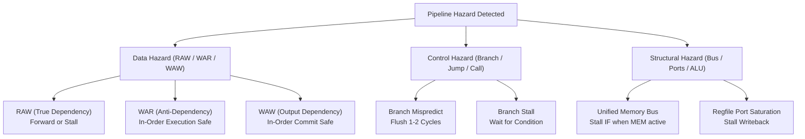
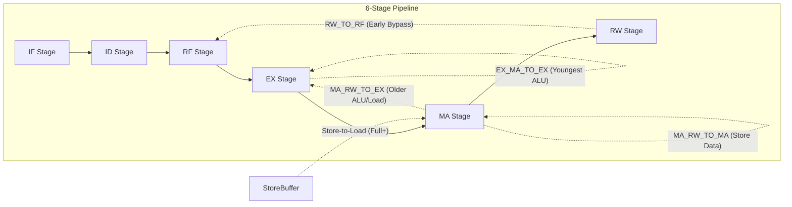

# Pipeline Hazards & The Data Forwarding Network

## 1. Pipeline Stage Definitions

The RISC201 architecture supports two distinct execution pipelines, both fully integrated with the memory hierarchy, dynamic branch predictor, and data forwarding network:

### 4-Stage Pipeline
1. **IF (Instruction Fetch):** Virtual address translation (ITLB $\rightarrow$ Page Walk), instruction cache access, and branch predictor lookup.
2. **OF (Operand Fetch / Decode):** 5-bit opcode decode, register file read with writeback bypass, and hazard stall evaluation.
3. **EX (Execute):** ALU operation, address calculation ($rs1 + \text{offset}$), branch condition evaluation, and data forwarding resolution.
4. **MARW (Memory Access & Register Writeback):** Data memory access ($ld / st$), TLB/cache translation, store buffer insertion, and register file commit.

### 6-Stage Pipeline
1. **IF (Instruction Fetch):** PC generation, ITLB translation, L1I cache line fetch, and branch prediction.
2. **ID (Instruction Decode):** 5-bit opcode slicing, immediate sign/zero expansion, branch target calculation, and scoreboarding.
3. **RF (Register Fetch):** Dual-port register read ($rs1, rs2$) with RW-to-RF writeback bypass.
4. **EX (Execute):** Arithmetic logic unit, branch resolution, multiplier/divider iteration, and EX-stage forwarding multiplexing.
5. **MA (Memory Access):** L1D cache read/write, StoreBuffer store-to-load forwarding, page fault exception vectoring.
6. **RW (Register Writeback):** Final architectural commit of ALU results or load data to register file.

---

## 2. Hazard Taxonomy & Detection

### 1. RAW (Read-After-Write, True Data Dependency)
Occurs when instruction $J$ in OF/ID/RF reads a register that older instruction $I$ in EX, MA, or WB will write.
- **Without Forwarding:** $J$ must stall until $I$ writes back to the register file (2 cycles on 4-stage, 3 cycles on 6-stage).
- **With Forwarding:** $J$ receives the computed result immediately from the pipeline latch of $I$ in 0 stall cycles, **except** for the Load-Use hazard.

### 2. Load-Use Hazard Interlock
A load instruction reads data from memory late in the pipeline (MARW in 4-stage, MA in 6-stage). If the immediate next instruction $J$ consumes the loaded register, data is physically not ready at the start of $J$'s EX stage:
$$\text{Load-Use Hazard} \iff \text{Producer.is\_load()} \land (\text{Producer.rd} = \text{Consumer.rs1} \lor \text{Producer.rd} = \text{Consumer.rs2})$$

**Hardware Resolution:**
The `HazardUnit` holds the consumer in OF/ID (`stall_if = True, stall_of = True`) and injects a synchronous bubble (`NOP`) into EX for **exactly 1 cycle**. In the subsequent cycle, the load has completed memory access and forwards the loaded data directly from MARW/MA to EX.

### 3. WAR (Write-After-Read) & WAW (Write-After-Write)
Because both RISC201 pipelines are strict in-order issue, in-order execute, and in-order commit pipelines, WAR and WAW hazards cannot cause architectural corruption. Registers are always updated in strict program order at writeback.

### 4. Structural Hazards
1. **Unified Memory Bus Contention:** When `--unified-mem` is active, instruction fetch (IF) and data access (MA) share a single physical port. If MA is active ($ld$ or $st$), IF is stalled for 1 cycle (`STRUCTURAL_MEM`).
2. **Register File Write Ports:** Parameterized via `--regfile-write-ports`. When multiple write requests compete, priority is granted to the oldest instruction.

---

## 3. Data Forwarding Network Architecture

### Forwarding Multiplexer Selection Codes
- `FWD_SEL_REG = 0`: Select operand from register file read port.
- `FWD_SEL_EXMEM = 1`: Select operand forwarded from younger stage (EX_MA / EX_MARW).
- `FWD_SEL_MEMWB = 2`: Select operand forwarded from older stage (MA_RW).

### Youngest-Producer Priority Rule
If multiple instructions ahead in the pipeline write to the same destination register, the forwarding multiplexer **must always select the youngest producer**:
$$\text{Selected Result} = \begin{cases} \text{EX\_MA.alu\_result} & \text{if } \text{EX\_MA.rd} = \text{Consumer.rs} \land \neg \text{EX\_MA.is\_load()} \\ \text{MA\_RW.result} & \text{else if } \text{MA\_RW.rd} = \text{Consumer.rs} \\ \text{RF.read\_port} & \text{otherwise} \end{cases}$$

### Store Data Forwarding (Separate from ALU Operand B)
For store instructions (`st rd, imm[rs1]`), the effective address is computed as $rs1 + imm$ in EX, while the store data is register $rd$. 
- Forwarding to the store data path must **never** corrupt ALU Operand B.
- Store data forwarding can occur in EX stage or directly in MA stage from MA_RW, requiring **0 stall cycles** even when following a load (`ld r1, 0[r2]; st r1, 4[r2]`).

### Store-to-Load Forwarding (Full+ Mode)
`Full+` mode integrates a 4-entry associative `StoreBuffer`. When a store executes in EX/MA, its physical address and data are entered into the buffer. When a subsequent load matches an uncommitted store address, data is forwarded immediately without waiting for DRAM or cache line write completion.

---

## 4. Minimum Stall Cycle Matrix

The following table summarizes the exact minimum stall cycles required between a Producer and a Consumer instruction across all forwarding configurations:

### 4-Stage Pipeline Minimum Stall Cycles
| Producer | Consumer | Distance | Mode: None | Mode: Basic | Mode: Full | Mode: Full+ |
| :--- | :--- | :---: | :---: | :---: | :---: | :---: |
| ALU Op | ALU Op | 1 | 2 | 0 | 0 | 0 |
| ALU Op | ALU Op | 2 | 1 | 0 | 0 | 0 |
| ALU Op | ALU Op | 3 | 0 | 0 | 0 | 0 |
| Load (`ld`) | ALU Op | 1 | 2 | 2 | 1 | 1 |
| Load (`ld`) | ALU Op | 2 | 1 | 1 | 0 | 0 |
| Load (`ld`) | Store (`st` data) | 1 | 2 | 2 | 0 | 0 |
| Store (`st`) | Load (`ld` same addr)| 1 | 0 | 0 | 0 | 0 (via SB) |

### 6-Stage Pipeline Minimum Stall Cycles
| Producer | Consumer | Distance | Mode: None | Mode: Basic | Mode: Full | Mode: Full+ |
| :--- | :--- | :---: | :---: | :---: | :---: | :---: |
| ALU Op | ALU Op | 1 | 3 | 0 | 0 | 0 |
| ALU Op | ALU Op | 2 | 2 | 0 | 0 | 0 |
| ALU Op | ALU Op | 3 | 1 | 0 | 0 | 0 |
| Load (`ld`) | ALU Op | 1 | 3 | 3 | 1 | 1 |
| Load (`ld`) | ALU Op | 2 | 2 | 2 | 0 | 0 |
| Load (`ld`) | Store (`st` data) | 1 | 3 | 3 | 0 | 0 |
| Store (`st`) | Load (`ld` same addr)| 1 | 0 | 0 | 0 | 0 (via SB) |

---

## 5. Formal Forwarding Assertion Mode (`--check-forwarding`)

To mathematically guarantee that no stale or incorrect values are forwarded into pipeline operands, `--check-forwarding` activates an automated formal verifier:
1. Every instruction decoded is tagged with a globally monotonic instance ID (`inst_id`).
2. When a value is forwarded from producer $P$ to consumer $C$:
   - If $P$ is retiring in the current cycle: the forwarded value is asserted against the architectural register file immediately:
     $$\text{assert } V_{\text{forwarded}} = \text{RegFile}[P.rd]$$
   - If $P$ has not yet retired: $(P.\text{inst\_id}, V_{\text{forwarded}})$ is placed into a shadow tracking table. When $P$ completes its writeback stage, the retired value is popped and verified:
     $$\text{assert } V_{\text{forwarded}} = V_{\text{retired}}$$
3. Any discrepancy halts simulation immediately with a detailed diagnostic exception.
