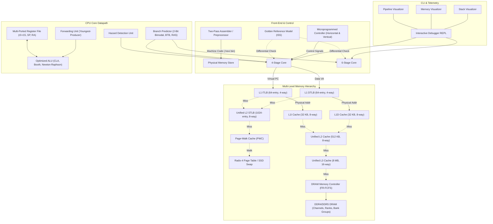
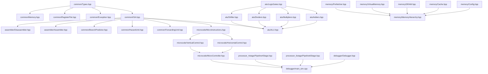

# Master Figures Index: RISC201 Architectural Diagrams

This document contains the complete set of architectural diagrams, circuit block diagrams, bitfield specifications, and pipeline flow charts for the RISC201 processor. Every diagram is provided in both **Mermaid format** (for markdown renderers and documentation) and **precise ASCII art** (for terminal viewing and raw text output).

---

## Figure 1: RISC201 System Architecture Block Diagram
**Caption**: Figure 1: Comprehensive System Block Diagram showing the Pipelined Core, Dual-Ported Harvard Memory Subsystem, Microcoded Control Engine, Optimized ALU, and Interactive Debugger Environment.

### Mermaid Diagram


### ASCII Diagram
```
+-----------------------------------------------------------------------------------------------------------------------------+
|                                                  RISC201 PIPELINED CPU CORE                                                 |
|                                                                                                                             |
|   Datapath Flow (4-Stage: IF -> OF -> EX -> MA_RW | 6-Stage: IF -> ID -> RF -> EX -> MA -> RW):                            |
|     +-------------+        +-------------+        +-------------+        +-------------+        +-------------+             |
|     |  Fetch (IF) | =====> | Decode (OF) | =====> | Exec (EX)   | =====> | Memory (MA) | =====> |  Write (RW) |             |
|     | (Virtual PC)|        |  (RegFile)  |        |    (ALU)    |        |  (Data VA)  |        |  (RegFile)  |             |
|     +------+------+        +-------------+        +-------------+        +------+------+        +-------------+             |
|            |                      ^                      ^                      |                      ^                    |
|            |                      |                      +--[Forwarding Unit]---+                      |                    |
|            |                      +---------------------[Hazard Detection Unit]------------------------+                    |
|            | Instruction Port                                                   | Data Port                                 |
|            | [Only IF accesses Instruction Memory]                              | [Only MA accesses Data Memory]            |
+------------|--------------------------------------------------------------------|-------------------------------------------+
             | Virtual PC                                                         | Virtual Address (VA)
             v                                                                    v
    +-----------------+                                                  +-----------------+
    |     L1 ITLB     |                                                  |     L1 DTLB     |
    | (64-entry, 4-way)|                                                  | (64-entry, 4-way)|
    +--------+--------+                                                  +--------+--------+
             | Miss                                                               | Miss
             +----------------------------------+---------------------------------+
                                                |
                                                v
                                      +--------------------+
                                      |      L2 STLB       |
                                      | (1024-entry, 8-way)|
                                      +---------+----------+
                                                | Miss
                                                v
                                      +--------------------+
                                      |   Page-Walk Cache  |
                                      |      (PWC)         |
                                      +---------+----------+
                                                | Miss / Page Walk
                                                v
                                      +--------------------+
                                      |  Physical Frames / |
                                      |  Swap Space (SSD)  |
                                      +--------------------+
             +----------------------------------+
             | Physical Address (PA)
             v
    +-----------------+                                                  +-----------------+
    |    L1I Cache    |                                                  |    L1D Cache    |
    | (32 KB, 8-way)  |                                                  | (32 KB, 8-way)  |
    +--------+--------+                                                  +--------+--------+
             | Line Miss                                                          | Line Miss
             +----------------------------------+---------------------------------+
                                                |
                                                v
                                      +--------------------+
                                      |      L2 Cache      |
                                      |  (512 KB, 8-way)   |
                                      +---------+----------+
                                                | Line Miss
                                                v
                                      +--------------------+
                                      |      L3 Cache      |
                                      |  (8192 KB, 16-way) |
                                      +---------+----------+
                                                | Line Miss (64 Bytes)
                                                v
                                      +--------------------+
                                      |  Memory Controller |
                                      | (FR-FCFS Scheduler)|
                                      +---------+----------+
                                                |
              +-------------------+-------------+-----+-------------------+--------------------+
              |                   |                   |                   |                    |
              v                   v                   v                   v                    v
        Channel 0 (64b)     Channel 1 (64b)     Subchannel A/B      Bank Group 0-3       Banks 0-15
        Rank 0 (Chips)      Rank 0 (Chips)      (DDR4 / DDR5)       Row Buffers (Hits)   Row Conflicts
```

---

## Figure 2: Module Dependency Graph (`#include` Analysis)
**Caption**: Figure 2: C++ Module Dependency Graph derived strictly from source file `#include` relationships.

### Mermaid Diagram


---

## Figure 3: Instruction Word Formats & Bitfields
**Caption**: Figure 3: RISC201 32-bit Instruction Word Layouts for R-Type, I-Type, B-Type, and Memory Access.

### ASCII Diagram
```
1. R-Type (Register-Register Arithmetic & Logic):
 31         27 26 25      22 21      18 17      14 13                       0
+-------------+--+----------+----------+----------+--------------------------+
|   Opcode    |0 |    rd    |   rs1    |   rs2    |      Unused (Zero)       |
|   (5 bits)  |  | (4 bits) | (4 bits) | (4 bits) |        (14 bits)         |
+-------------+--+----------+----------+----------+--------------------------+

2. I-Type (Register-Immediate Arithmetic, Logic, Load, Store):
 31         27 26 25      22 21      18 17                             2 1  0
+-------------+--+----------+----------+--------------------------------+----+
|   Opcode    |1 |    rd    |   rs1    |       Immediate Value          |mod |
|   (5 bits)  |  | (4 bits) | (4 bits) |           (16 bits)            |(2b)|
+-------------+--+----------+----------+--------------------------------+----+
                                        mod: 00 = Unsigned, 01 = High (<<16), 10 = Signed

3. B-Type (Conditional Branch, Unconditional Jump, Subroutine Call):
 31         27 26                                                           0
+-------------+--------------------------------------------------------------+
|   Opcode    |                 Signed Branch Offset (imm27)                 |
|   (5 bits)  |               (27-bit PC-relative word offset)               |
+-------------+--------------------------------------------------------------+
 Target PC = Current PC + (SignExtend(imm27) * 4)
```

---

## Figure 4: 4-Stage vs 6-Stage Pipeline Latches & Execution Timing
**Caption**: Figure 4: Side-by-side Pipeline Comparison illustrating Stage Merging in the 4-Stage Core vs. Stage Splitting in the 6-Stage Core.

### ASCII Diagram
```
4-STAGE PIPELINE (Merged MA_RW):
+--------+   Latch   +--------+   Latch   +--------+   Latch   +-----------+
|   IF   | --------> |   OF   | --------> |   EX   | --------> |   MA_RW   |
| (Fetch)|  (IF/OF)  | (Decode|  (OF/EX)  | (ALU / | (EX/MARW) | (Memory & |
|        |           |  & RF) |           | Branch)|           | Writeback)|
+--------+           +--------+           +--------+           +-----------+
    |                                         ^                      |
    +----------- Branch Mispredict Flush -----+                      |
    |            (Penalty: 2 cycles)                                 |
    +<---------- Full Forwarding Bypass <----------------------------+

6-STAGE PIPELINE (Split ID & RF, Dedicated MA & RW):
+--------+  Latch  +--------+  Latch  +--------+  Latch  +--------+  Latch  +--------+  Latch  +--------+
|   IF   | ------> |   ID   | ------> |   RF   | ------> |   EX   | ------> |   MA   | ------> |   RW   |
| (Fetch)| (IF/ID) |(Decode)| (ID/RF) | (Read) | (RF/EX) | (ALU)  | (EX/MA) | (Mem)  | (MA/RW) | (Write)|
+--------+         +--------+         +--------+         +--------+         +--------+         +--------+
    |                                                        ^                  |                  |
    +---------------- Branch Mispredict Flush ---------------+                  |                  |
    |                 (Penalty: 3 cycles)                                       |                  |
    +<--------------- EX-to-EX Bypass <----------------------+                  |                  |
    +<--------------- MEM-to-EX Bypass <----------------------------------------+                  |
    +<--------------- WB-to-EX Bypass <------------------------------------------------------------+
```

---

## Figure 5: Forwarding Paths & Youngest-Producer Multiplexer Network
**Caption**: Figure 5: Complete Forwarding Bypass Multiplexer Architecture for ALU Operand Routing.

### ASCII Diagram
```
                    Stage EX Latch (Producing Result)
                                 |
                                 +-----------------------------------+
                                 |                                   |
                    Stage MA Latch (Memory / ALU Result)             |
                                 |                                   |
                                 +-----------------+                 |
                                 |                 |                 |
                    Stage RW Latch (Writeback Data)|                 |
                                 |                 |                 |
                                 +-------+         |                 |
                                 |       |         |                 |
Register File Port A             v       v         v                 v
          |                 +---------------------------------------------+
          +---------------->| MUX A (Select: Reg, WB, MEM, EX)            |=====> ALU Input A
                            +---------------------------------------------+
                                                 ^
                                                 | Forward Decision Logic (Youngest Producer: EX > MEM > WB)
Register File Port B                             |
          |                 +---------------------------------------------+
          +---------------->| MUX B (Select: Reg, WB, MEM, EX, Imm)      |=====> ALU Input B
                            +---------------------------------------------+
```

---

## Figure 6: Microcode Control Word Formats
**Caption**: Figure 6: Bit allocations for Horizontal (65-bit) and Vertical (45-bit) Micro-Instruction Words.

### ASCII Diagram
```
HORIZONTAL CONTROL WORD (65 bits):
 64         55 54        45 44        33 32 31 30 29 28                         0
+-------------+------------+------------+-----+-----+----------------------------+
|  Func Args  | Branch Tgt |   uimm     | uF  |Xfer | Discrete Control Signals   |
|  (10 bits)  | (10 bits)  | (12 bits)  | MUX | MUX |         (33 bits)          |
+-------------+------------+------------+-----+-----+----------------------------+
                                          (2b)  (2b)  Direct hardware bit lines

VERTICAL MICRO-INSTRUCTION (45 bits packed into uint64_t):
 44         42 41        37 36        32 31        20 19        10 9                0
+-------------+------------+------------+------------+------------+------------------+
|   MicroOp   |  Src Reg   |  Dest Reg  | Immediate  | Branch Tgt | Functional Args  |
|  (3 bits)   |  (5 bits)  |  (5 bits)  | (12 bits)  | (10 bits)  |    (10 bits)     |
+-------------+------------+------------+------------+------------+------------------+
```

---

## Figure 7: Virtual Memory 4-Level Radix Page Table Walk
**Caption**: Figure 7: Radix-4 Translation Architecture mapping 48-bit Virtual Addresses to Physical Frames via PML4, PDPT, PD, PT, and PWC.

### ASCII Diagram
```
Virtual Address (48 bits):
 47        39 38        30 29        21 20        12 11                         0
+------------+------------+------------+------------+----------------------------+
| PML4 Index | PDPT Index |  PD Index  |  PT Index  |        Page Offset         |
|  (9 bits)  |  (9 bits)  |  (9 bits)  |  (9 bits)  |         (12 bits)          |
+------------+------------+------------+------------+----------------------------+
       |            |            |            |                   |
       | +-[PWC Hits]            |            |                   |
       v v                       |            |                   |
  +----------+                   |            |                   |
  |   PML4   |                   |            |                   |
  |  Table   |                   |            |                   |
  +----+-----+                   |            |                   |
       | Base Address            |            |                   |
       v                         v            |                   |
  +----------+              +----------+      |                   |
  |   PDPT   | -----------> |    PD    |      |                   |
  |  Table   |              |  Table   |      |                   |
  +----------+              +----+-----+      |                   |
                                 | Base       v                   |
                                 +-------> +----------+           |
                                           |    PT    |           |
                                           |  Table   |           |
                                           +----+-----+           |
                                                | Physical Frame  |
                                                v                 v
                                           +----------------------------+
                                           |   Physical Address (PA)    |
                                           +----------------------------+
```

---

## Figure 8: Full-Descending Stack Frame Memory Layout
**Caption**: Figure 8: Memory Layout of the Active Stack Frame showing Frame Base, Local Variables, Saved RA ($r_{15}$), Stack Pointer ($r_{14}$), and Guard Page Boundary.

### ASCII Diagram
```
High Memory (0x7FFFFFFF)
+-------------------------------------------------------+
| ... Caller's Previous Stack Frame ...                 |
+-------------------------------------------------------+ <--- Frame Base (Previous SP)
| Saved Parameter / Argument Words                      |
+-------------------------------------------------------+
| Local Variable 1                                      |
+-------------------------------------------------------+
| Local Variable 2                                      |
+-------------------------------------------------------+
| Saved Return Address (RA = r15 from 'call')           |
+-------------------------------------------------------+ <--- Current Stack Pointer (SP = r14)
|               |                                       |
|               | (Stack Grows Downwards on 'push')      |
|               v                                       |
|                                                       |
| Free Stack Space                                      |
|                                                       |
+=======================================================+ <--- STACK GUARD PAGE BOUNDARY
| [PROTECTED GUARD PAGE - ACCESS RAISES STACK OVERFLOW] |
+=======================================================+
Low Memory (0x00000000)
```

