# Chapter 4: System Architecture Overview

## 4.1 System-Level Block Diagram
The RISC201 processing environment integrates software generation tools, cycle-accurate microarchitectural pipelines, a multi-level Harvard memory hierarchy, a microprogrammed control unit, and interactive visualization telemetry into a unified C++ framework.

Figure 4.1 illustrates the structural interconnect of the entire system:

```
+-------------------------------------------------------------------------------------------------------------+
|                                              RISC201 SYSTEM ARCHITECTURE                                    |
|                                                                                                             |
|   +-----------------------+              +------------------------+             +-----------------------+   |
|   |  Two-Pass Assembler   | ===========> |  Machine Code Storage  | ==========> |   Instruction Fetch   |   |
|   |  & Macro Preprocessor |              |  (.hex / .bin buffers) |             |        (IF)           |   |
|   +-----------------------+              +------------------------+             +-----------+-----------+   |
|                                                                                             |               |
|   +-----------------------+                                                                 | Virtual PC    |
|   |  Microcode Controller |                                                                 v               |
|   |  (Horiz / Vert ROM)   | <---+                                                  +-----------------+      |
|   +-----------------------+     |                                                  |     L1 ITLB     |      |
|                                 | Control                                          +--------+--------+      |
|                                 | Signals                                                   | PA            |
|   +-----------------------+     |                                                           v               |
|   |   Hazard Detection    | ----+      +--------------------+                      +-----------------+      |
|   |   & Stall Control     | ---------> |  Operand Fetch     |                      |    L1I Cache    |      |
|   +-----------------------+            |  / Decode (OF/ID)  |                      | (32 KB, 8-way)  |      |
|                                        +---------+----------+                      +--------+--------+      |
|                                                  | Read Regs                                | Miss          |
|                                                  v                                          v               |
|   +-----------------------+            +--------------------+                      +-----------------+      |
|   |  Forwarding Bypass    | =========> |  ALU Execution     |                      |    L2 Cache     |      |
|   |  (Youngest Producer)  |            |  (CLA, Booth, NR)  |                      | (512 KB, 8-way) |      |
|   +-----------------------+            +---------+----------+                      +--------+--------+      |
|                                                  | Result / Address                         | Miss          |
|                                                  v                                          v               |
|   +-----------------------+            +--------------------+    Data VA           +-----------------+      |
|   |  Branch Predictor     | ---------> |  Memory Access     | ===================> | L1 DTLB / L1D   |      |
|   |  (2-Bit, BTB, RAS)    |            |       (MA)         |                      +--------+--------+      |
|   +-----------------------+            +---------+----------+                               | Miss          |
|                                                  |                                          v               |
|                                                  v                                 +-----------------+      |
|                                        +--------------------+                      |    L3 Cache     |      |
|                                        | Register Writeback |                      | (8 MB, 16-way)  |      |
|                                        |       (RW)         |                      +--------+--------+      |
|                                        +--------------------+                               | Miss          |
|                                                                                             v               |
|   +---------------------------------------------------------+                      +-----------------+      |
|   | Interactive Debugger REPL & Visualizers (Pipe, Mem, Stk)|                      | DDR4/DDR5 DRAM  |      |
|   +---------------------------------------------------------+                      +-----------------+      |
+-------------------------------------------------------------------------------------------------------------+
```

---

## 4.2 C++ Module Dependency Architecture
The codebase strictly enforces modular header-only and compilation dependencies. Figure 4.2 details the physical `#include` dependency hierarchy across all modules:

```mermaid
graph TD
    subgraph CommonLayer ["Foundation Layer (common/)"]
        Types["Types.hpp"] --> ISA["ISA.hpp"]
        Types --> Exception["Exception.hpp"]
        Types --> RegFile["RegisterFile.hpp"]
        Types --> Mem["Memory.hpp"]
        ISA --> Forwarding["ForwardingUnit.hpp"]
        ISA --> Hazard["HazardUnit.hpp"]
        ISA --> Branch["BranchPredictor.hpp"]
        Types --> Perf["PerformanceTracker.hpp"]
        ISA --> ISS["ISS.hpp"]
    end

    subgraph ALULayer ["Arithmetic Logic Layer (alu/)"]
        Logic["LogicGates.hpp"] --> Adders["Adders.hpp"]
        Logic --> Multipliers["Multipliers.hpp"]
        Logic --> Dividers["Dividers.hpp"]
        Logic --> Shifter["Shifter.hpp"]
        Adders --> ALU["ALU.hpp"]
        Multipliers --> ALU
        Dividers --> ALU
        Shifter --> ALU
        ISA --> ALU
    end

    subgraph MemoryLayer ["Memory Subsystem (memory/)"]
        AddrMap["AddressMapping.hpp"] --> DRAM["DRAM.hpp"]
        Config["Config.hpp"] --> MemHier["MemoryHierarchy.hpp"]
        Cache["Cache.hpp"] --> MemHier
        DRAM --> MemHier
        VM["VirtualMemory.hpp"] --> MemHier
        Prefetch["Prefetcher.hpp"] --> MemHier
    end

    subgraph MicrocodeLayer ["Microprogrammed Control (microcode/)"]
        MicroInst["MicroInstructions.hpp"] --> Horiz["HorizontalControl.hpp"]
        MicroInst --> Vert["VerticalControl.hpp"]
        Horiz --> MCU["MicroController.hpp"]
        Vert --> MCU
        ISA --> MicroInst
    end

    subgraph PipelineLayer ["Pipeline Implementations"]
        Reg4["StageRegisters4.hpp"] --> P4["Pipeline4Stage.hpp"]
        Reg6["StageRegisters6.hpp"] --> P6["Pipeline6Stage.hpp"]
        ALU --> P4
        ALU --> P6
        MemHier --> P4
        MemHier --> P6
        Forwarding --> P4
        Forwarding --> P6
        Hazard --> P4
        Hazard --> P6
        Branch --> P4
        Branch --> P6
    end

    subgraph SoftwareTools ["Assembler, Debugger, and Evaluation"]
        Macro["MacroPreprocessor.hpp"] --> Asm["Assembler.hpp"]
        ISA --> Asm
        ISA --> Disasm["Disassembler.hpp"]
        VisP["PipelineVisualizer.hpp"] --> Debug["Debugger.hpp"]
        VisM["MemoryVisualizer.hpp"] --> Debug
        VisS["StackVisualizer.hpp"] --> Debug
        P4 --> Debug
        P6 --> Debug
        MCU --> Debug
        Debug --> MainSim["main_sim.cpp"]
    end
```



---

## 4.3 End-to-End Instruction Lifecycle (A Worked Dataflow Walkthrough)
To observe how all subsystems interact dynamically, consider the lifecycle of an indexed load instruction:
```assembly
ld r3, 8[r2]       ; r3 <- Mem[r2 + 8]
```
Assuming initial state: `PC = 0x00000020`, `r2 = 0x1000`, `Mem[0x1008] = 0x42`.

### Step 1: Instruction Fetch (`IF`)
* **Cycle 1**:
  * Core sends `Virtual PC = 0x00000020` to `MemoryHierarchy`.
  * Virtual Memory translates address: queries `L1 ITLB`. Hit in ITLB $\implies$ yields `Physical PC = 0x00000020`.
  * `L1I Cache` queried with `PA = 0x00000020`. 1-cycle hit returns 32-bit machine code word:
    $$\text{Word} = \text{0x73140022} \implies \text{"01110 1 0011 0010 0000000000001000 10"}$$
  * `BranchPredictor` inspects opcode `"01110"`: non-branch instruction $\implies$ predicts sequential $\text{PC} + 4 = \text{0x00000024}$.
  * Instruction word and bitstring latched into `Latch_IF_ID`.

### Step 2: Instruction Decode (`ID`)
* **Cycle 2**:
  * Hardware decoder extracts bitfields:
    * `opcode` = `sliceField(bits, 31, 27)` = `"01110"` (`OP_LD`).
    * $r_d = 3$, $r_{s1} = 2$, $imm_{16} = 8$, $mod = 10$ (`MOD_S`).
  * Sign extender sign-extends immediate: $8 \rightarrow \text{0x00000008}$.
  * Instruction metadata queried: `isLoad = true`, `readsRs1 = true`, `writesRd = true`.
  * Decoded control bundle latched into `Latch_ID_RF`.

### Step 3: Register Fetch & Hazard Resolution (`RF`)
* **Cycle 3**:
  * Physical register file read ports accessed: Port 1 reads `r2 = 0x1000`.
  * `HazardUnit` checks active destinations in `EX` and `MA`: no older uncommitted instructions modify `r2`.
  * `ForwardingUnit` confirms register value is fresh (`FWD_FROM_REG`).
  * Operand values latched into `Latch_RF_EX`: `valRs1 = 0x1000`, `imm = 8`.

### Step 4: Execute & Effective Address Calculation (`EX`)
* **Cycle 4**:
  * `ALU` receives operands: $A = \text{0x1000}$, $B = \text{0x00000008}$.
  * Adder computes Effective Address:
    $$\text{EA} = 0x1000 + 0x0008 = \mathbf{0x1008}$$
  * No branch evaluation needed.
  * Target address latched into `Latch_EX_MA`.

### Step 5: Memory Access (`MA`)
* **Cycle 5**:
  * Core sends `Virtual Address VA = 0x1008` to `MemoryHierarchy`.
  * `StoreBuffer` CAM searched: no pending in-flight stores to address `0x1008`.
  * `L1 DTLB` queried: 1-cycle hit translates `VA = 0x1008` $\rightarrow$ `PA = 0x1008`.
  * `L1D Cache` queried: 1-cycle hit returns data word $\text{0x00000042}$ (integer 66).
  * Data word latched into `Latch_MA_RW`.

### Step 6: Register Writeback (`RW`)
* **Cycle 6**:
  * Writeback stage receives loaded word $\text{0x00000042}$ and destination register index $r_d = 3$.
  * Hardware checks $r_d \ne 0$ (protecting hardwired zero `r0`).
  * Writes $\text{0x00000042}$ into Register File at register `r3`.
  * Instruction retires: `PerformanceTracker.retiredInstructions++`.

